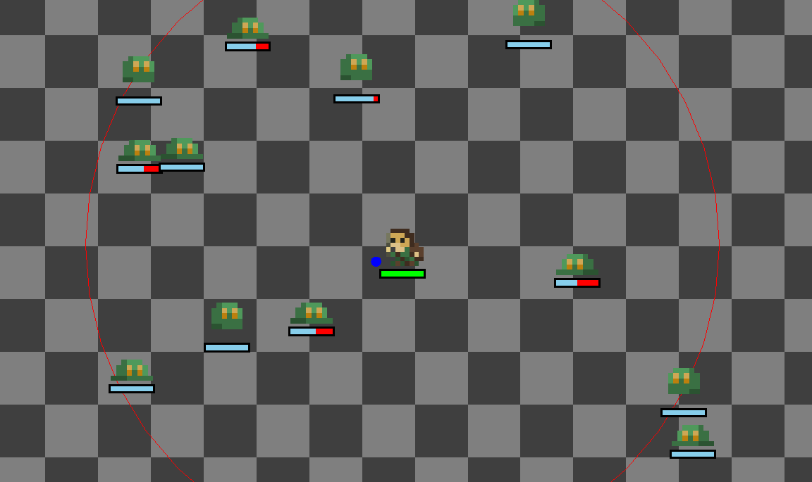
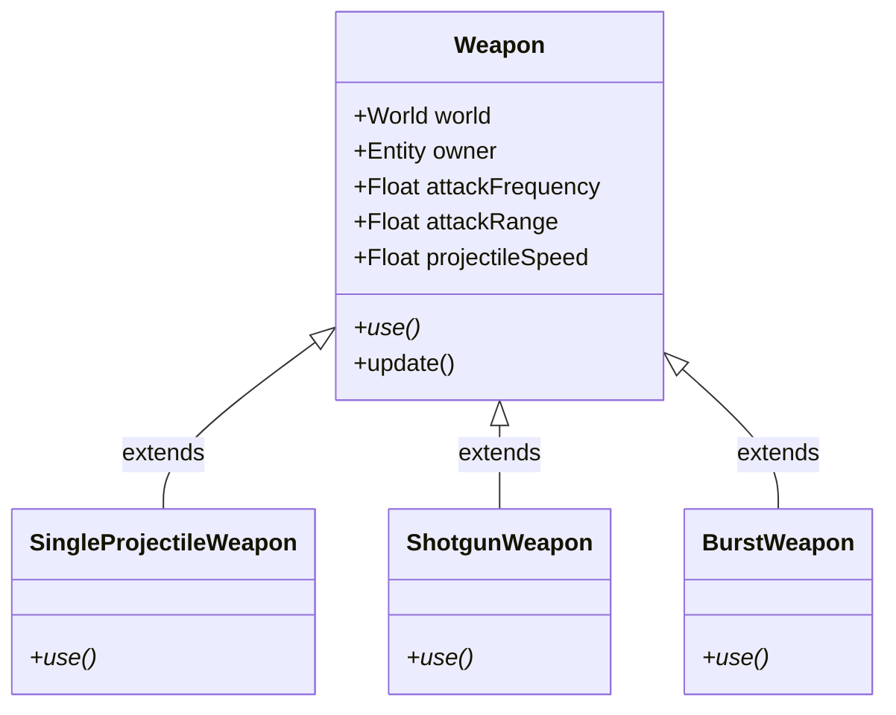
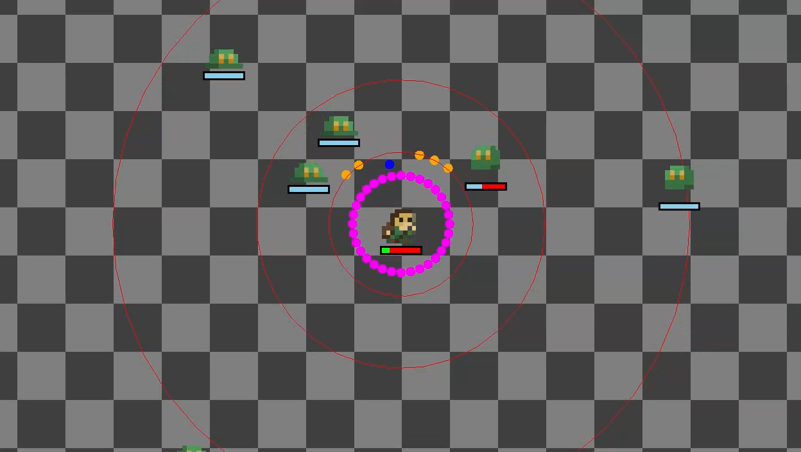

## The Codebase

In the previous [intro post](/finish-line/20261031-intro), I mentioned I was reusing an existing codebase for a vampire survivors clone, codenamed "Kamps", I was trying to make in 2023.

This has the advantage of me not having to start from scratch, however one disadvantage is that the purpose, and thus design decisions of that original project carry over to a new project with completely different goals in mind.

The original codebase, named 'Kamps', was mainly just me messing with Kotlin and libgdx. The codebase uses [ktx](https://github.com/libktx/ktx) for nicer Kotlin-specific integration, and also [Fleks](https://github.com/Quillraven/Fleks) to provide an ECS engine driving most of the game logic. I had previous experience with libgdx for larger projects, and at the time I was wanting to learn Kotlin. I also wanted to see what using an ECS library would look like, as my previous ECS projects all used an in-house solution.

It may make more sense to use something closer to 'commercial' game engines like Godot, but in theory, I shouldn't run into any hard obstacles even with libgdx. Although at a base level the Kamps codebase wasn't created with the same goal of creating a fully fleshed out game, libgdx is still a pretty complete framework to create a game out of. A friend of mine also made the point that I can rewrite the game later on anyways; at this conceptualization stage, it's more important for me to make immediate progress to flesh out my idea. With all that being said, I'm willing to accept the tradeoffs and build off of what I already have. I have always been a big believer that getting started on something is often half the battle, so why go through that effort again? 

The Kamps codebase wasn't too far along when I picked it back up. I was only just as far as having a few circles on the screen which automatically shoot projectiles at other circles. After adding some temporary placeholder sprites from OpenGameArt ([credit here](https://opengameart.org/content/roguelite)), the game looked like this:



Just a simple world with a player shooting simple projectiles (the blue dot next to the player in the center) along a checkered background.

## What is an ECS?

For those of you who aren't familiar with an ECS, here is a quick explanation using my physics system.

This is the entirety of the code which drives the game's 'physics':

```kotlin {linenos=inline}
class SPhysics : IteratingSystem(family { all(CPosition, CVelocity) }) {
    override fun onTickEntity(entity: Entity) {
        val position = entity[CPosition].value
        val velocity = entity[CVelocity].value

        position.x += velocity.x * deltaTime
        position.y += velocity.y * deltaTime

        if (entity.has(CPlayer) && entity.has(CDimension)) {
            // Handle player moving out of world bounds.
            val dimension = entity[CDimension]

            if (dimension !is CCircleDimension) throw NotImplementedError("Player cannot be a rectangle!")

            position.x = if (position.x - dimension.radius < 0) {
                dimension.radius
            } else if (position.x + dimension.radius > WORLD_SIZE) {
                WORLD_SIZE - dimension.radius
            } else {
                position.x
            }


            position.y = if (position.y - dimension.radius < 0) {
                dimension.radius
            } else if (position.y + dimension.radius > WORLD_SIZE) {
                WORLD_SIZE - dimension.radius
            } else {
                position.y
            }
        }
    }
}
```

There are some weird pieces here (e.g. Player cannot be a rectangle??) which come from the nature of me exploring Kotlin's features. Existing code being over-engineered has been a common theme during my re-adopting of this codebase.

Anyways, back to the explanation.

What you are looking at here is a System: the S in ECS. A system can just be thought of as logic. This is the actual functions that act on the data and ultimately transform the state of the game. In practice these are usually the most complex parts of the code.

Which leads me to the next part, Components: the C in ECS. If you look at lines 2 and 3 you will notice the `CPosition` and `CVelocity` data types. These are components. In other domains of computer science you might call these records or models. They are simply containers of data to represent state.

Here what the `CPosition` component looks like:
```kotlin
data class CPosition(
    val value: Vector2 = Vector2(0f, 0f)
) : Component<CPosition> {
    val previous: Vector2 = value.cpy()
    // fleks boilerplate excluded for brevity
}
```

Ignoring the Fleks specific boilerplate I excluded, this is fairly straightforward. It's just a class which holds a single 2D vector and it's previous value.

Finally are Entities: the E in ECS. You will notice in lines 3 and 4 of the physics system, I appear to index into some sort of `Entity` object. As you may expect, an entity is something that exists in the world. For understanding the concept of an entity, I like to borrow from an explanation my friend gave me which thinks of an ECS as a relational database. This will all come together later on, but for now you can simply think of an entity as a row in a traditional relational database.

To put it all together, lets take a look at the class definition on line 1. The point of interest is the snippet passed into the parent `IteratingSystem` constructor: `family { all(CPosition, CVelocity) }`. Without getting too much into Fleks specific territory, you can just think of this as saying "For this system, only execute on entities which contain a `CPosition` and  a `CVelocity`".

At it's core, this is just querying. Going back to the database analogy, the whole workflow can be thought of a SQL query like so:
```mysql
SELECT Position, Velocity FROM Entities
WHERE Position IS NOT NULL AND Velocity IS NOT NULL
```

The class definition on line 1 is the `WHERE` clause, and the `SELECT` statement is the component access on lines 3 and 4. The system then executes logic on the data returned by this 'query' and writes back to the entities 'table'.

To summarize, we are grabbing a row of a table (the entity), taking the columns (the components), and using the data from the columns to transform the state of the game (the system).

If done properly, using an ECS has performance advantages due to the architecture naturally being great for cache locality. However, my favorite (admittedly subjective) advantage of ECS is the beauty in how modular and data driven your code ends up being.

The simple 30 lines of code I pasted above handles __all__ entities in the game. Every bullet, enemy, and future entities I come up with can move around the screen at a specified velocity through those 30 lines. And best of all, to allow an entity to move, I simply just need to give it the data it needs to have this behavior. Adding bullet projectiles to the world ends up looking like this:

```kotlin
fun spawnBullet(params: BulletSpawnParams): Entity {
    with (params) {
        return world.entity {
            it += CPosition(spawnPosition)
            it += CVelocity(params.velocity)
            it += CCircleDimension(5f)
            it += CColor(params.color)
            it += CCollider(mask = ENEMY_LAYER, layer = PROJECTILE_LAYER, onCollision = ::projectileOnCollision)
            it += CDamage(damage)
            it += CLifespan(lifespan)
        }
    }
}
```

You can probably guess what this bullet does from the components added.

I essentially just need to provide a blueprint of what state the entity contains, and the ECS handles the behavior on it's own. Do I want my entity to move around? Simply give it a `CPosition` and a `CVelocity`. This is intuitive to real life -- if something moves in the real world it must have a position and velocity. Only two lines of code to specify an entire behavior. Behavior is directly driven by data. Data is easy to combine, compose, and reason about. Data boils down to simple behavior; data, and thus simple behaviors, are composed together to create sophisticated behaviors. Simple machines working together to do something complex. _Chefs kiss_.

Full disclaimer, I am a fan of languages Clojure for it's data-first design, so this does naturally align with my preference for reasoning about code. As great as I make it sound here, of course like anything ECS isn't a one size fit all solution. In practice, it is harder to reason about compared to usual node-based or OOP approaches, especially for smaller projects. And the performance benefit is probably negligible for most game genres. 

## Adding items

The goal for this block was to add a concept of items to my game.

Items will be the main building blocks of the game, so this was naturally a good first goal.

Ironically, after praising ECS so much, in order to add items, I decided implement everything outside of the ECS. Like I said earlier, not all problems are easiest to reason about with an ECS.

The reason I decided to implement items outside of ECS-land is because these items more or less will have very specific behavior, and won't necessarily share behavior. The only shared behavior would be the way the game invokes/uses the weapons. Each weapon would be invoked at a specific cadence or frequency, but could possibly interact with the world in drastically different ways. One weapon could fire projectiles in a straight line, one could fire heat seeking projectiles, some could just cause status effects. If I were to implement this in ECS-land I would have to make specialized components and systems for each particular behavior. Also, the game won't have large amounts of weapons in the world compared to something like bullets. Therefore, the performance benefit doesn't exist. For these reasons, I felt a simple class hierarchy was easier to work with. Here's a mermaid chart of what I ended up with:



I started with 3 types of simple weapons I had in mind:
- A single projectile weapon which shoots a single stream bullets straight to an enemy.
- A shotgun weapon which shoots a spread of bullets at an enemy.
- A 'burst' weapons which shoots bullets in all directions around the player at once.

Of course, I want my final game to have a lot more weapons that work in completely different ways outside of shooting basic projectiles. However, I think this is a good starting point for now.

The implementation is pretty simple for now. The update function of the base Weapon class is just a timer which invokes the weapon based on the attackFrequency set:

```kotlin
// Weapon base class
fun update() {
    this.timeElapsed += world.deltaTime
    if (this.timeElapsed > this.attackFrequency) {
        this.use()
        this.timeElapsed = 0f
    }
}
```

Then, the player class holds a list of equipped weapons:
```kotlin
data class CPlayer(
    var moveSpeed: Float = DEFAULT_MOVE_SPEED,
) : Component<CPlayer> {
    val weapons = mutableListOf<Weapon>()

    override fun type() = CPlayer

    companion object : ComponentType<CPlayer>() {
        const val DEFAULT_MOVE_SPEED = 200f
    }
}
```

Each weapon in the list is updated on every tick. Within each weapon subclass, I can spawn entities by calling `World.entity` from Fleks' `World` object which essentially manages the state of the game. Within each weapon's `use` function, I can basically just call the `spawnBullets` function shown above with some additional logic on top. I ended up taking advantage of Kotlin having higher order function support:

```kotlin
// SingleProjectileWeapon
override fun use() {
  bulletsTowardsNearestEntity(::spawnBullet)
}   
// ShotgunWeapon
override fun use() {
  bulletsTowardsNearestEntity(::spawnShotgunBullets)
}
```

`bulletsTowardsNearestEntity` is just a utility function which spawns bullets towards the nearest entity to the caller using the passed in function.

After all this, I am now able to have 3 weapons!



The 3 red circles are the different ranges, and the 3 different colors are projectiles from different weapons.

## Outro and Next Goal

This first block was pretty straightforward. I probably spent more time on this blog post than the actual code, but I think it's a good start.

For next weeks goal, I'll continue with the weapons theme and add stats and modifiers to the existing weapons. As a stretch goal, I also want to try to add some sort of shop somewhere to buy weapons.
